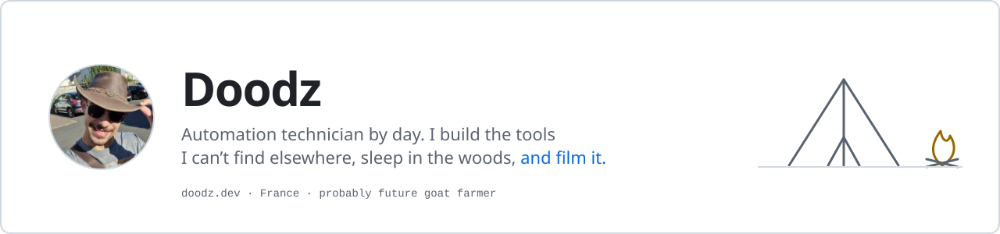
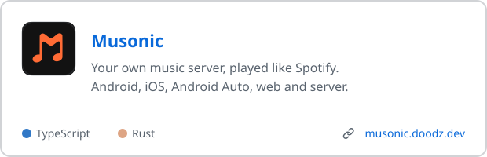
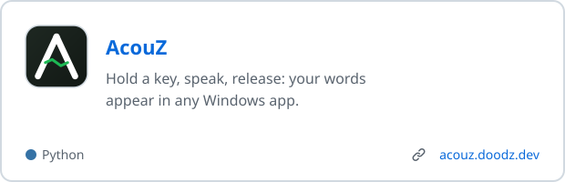
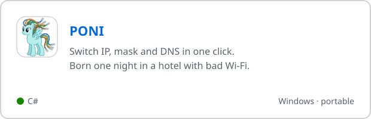
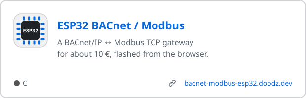

<a href="https://doodz.dev">
  <picture>
    <source media="(prefers-color-scheme: dark)" srcset="assets/banner-dark.svg">
    
  </picture>
</a>

  <a href="https://doodz.dev"><b>doodz.dev</b></a> &nbsp;·&nbsp;
  <a href="https://www.youtube.com/c/Doodz"><b>YouTube</b></a> &nbsp;·&nbsp;
  <a href="mailto:contact@doodz.dev"><b>contact@doodz.dev</b></a>

## What I build

  <a href="https://github.com/DoodzDev/Musonic"><picture><source media="(prefers-color-scheme: dark)" srcset="assets/card-musonic-dark.svg"></picture></a>
  <a href="https://github.com/DoodzDev/AcouZ"><picture><source media="(prefers-color-scheme: dark)" srcset="assets/card-acouz-dark.svg"></picture></a>
  <a href="https://github.com/DoodzDev/PONI"><picture><source media="(prefers-color-scheme: dark)" srcset="assets/card-poni-dark.svg"></picture></a>
  <a href="https://github.com/DoodzDev/ESP32-BMS-Gateway-Multi-Protocol"><picture><source media="(prefers-color-scheme: dark)" srcset="assets/card-esp32-dark.svg"></picture></a>

## Right now

Building Musonic's own Android Auto screens. Podcasts are next.

## Elsewhere

- **[Doodz](https://www.youtube.com/c/Doodz)** on YouTube: bivouacs, bushcraft and the occasional vlog.
- **[gaetanlcf](https://www.youtube.com/@gaetanlcf)**: technical companion videos for some of these repos.
- My gear, field guides and projects live on **[doodz.dev](https://doodz.dev)**.

## Support

If something I built saved you time, you can [buy me a coffee on PayPal](https://www.paypal.com/donate?hosted_button_id=UFY7N3WCJ5T4E) or send crypto:

| | Address | Network |
|---|---|---|
| **BTC** | `bc1qwxsakp452llzrd6y9px65x24k5ul5cmtnystal` | Bitcoin only |
| **ETH** | `0xFef0FA58F2aE42a4F1453F1D86332d6eda962572` | Ethereum mainnet only |
